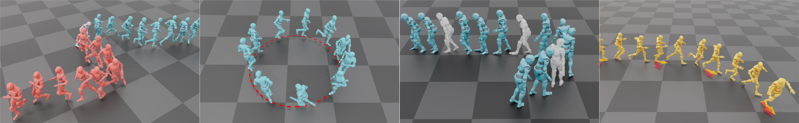

# <p align="center"> Interactive Character Control with Auto-Regressive Motion Diffusion Models </p>
### <p align="center"> [Yi Shi](https://github.com/Yi-Shi94/), [Jingbo Wang](https://wangjingbo1219.github.io/), [Xuekun Jiang](), [Bingkun Lin](), [Bo Dai](https://daibo.info/), [Xue Bin Peng](https://xbpeng.github.io/) </p>
<p align="center">
  
</p>

## Links
[page](https://yi-shi94.github.io/amdm_page/) | [paper](https://arxiv.org/pdf/2306.00416v4) | [video](https://www.youtube.com/watch?v=5WE9hy0xCI4&ab_channel=YISHI) | [poster](https://docs.google.com/presentation/d/1KRxJh2ZoyV7dtKd25s_R4KGqslxCJyeqm5OGw24TKZU/edit?usp=sharing) | [slides](https://docs.google.com/presentation/d/1kA_LT9zi4nb7FbJjZGD_g692NfGSKbfXBuVEQxUEXAg/edit?usp=sharing)


## Interactive Control

PPO controllers that steer a frozen, T=16 A-MDM prior trained on LAFAN1, with a real-time MuJoCo viewer (SMPL mesh or
capsule person), Xbox joystick input, clickable targets and hand-drawn paths:

- **target**: walk to a target that can move at any time
- **path**: follow a path whose speed varies from standstill to 4 m/s while holding a separate facing direction
  (plus a variant that always faces along the path)
- **joystick**: forward / sideways speed and turning commands (plus a forward-speed-only variant)

Everything lives in [`interactive_control/`](interactive_control/README.md); run all commands from there.

### Install

Tested with Python 3.10, PyTorch 1.13.1 (CUDA 11.7), MuJoCo 3.10 and pygame 2.6 on Linux.

```bash
git clone https://github.com/Yi-Shi94/AMDM.git
cd AMDM/interactive_control
pip install -r requirements.txt
```

### Download checkpoints and data

```bash
bash scripts/download.sh             # prior + 5 controllers + LAFAN1 clips (~250 MB), checksummed, unpacked in place
bash scripts/download.sh --no-lafan  # if you already have LAFAN1 (put its .bvh files in data/LAFAN1/)
```

The files are on the [interactive-v1.0 release](https://github.com/Yi-Shi94/AMDM/releases/tag/interactive-v1.0)
if you prefer to download them by hand. Unzip each inside `interactive_control/`:

| Archive | Contents | Unpacks to |
|---|---|---|
| `amdm_lafan1_t16.zip` (108 MB) | T=16 LAFAN1 prior | `output/base/amdm_lafan1_t16/` |
| `amdm_interactive_controllers.zip` (25 MB) | target, path, path_forward, joystick, joystick_1d controllers | `output/interactive/` |
| `lafan1_bvh.zip` (120 MB) | the 60 LAFAN1 clips used ([Ubisoft La Forge](https://github.com/ubisoft/ubisoft-laforge-animation-dataset), CC BY-NC-ND 4.0) | `data/LAFAN1/` |

The first run parses the clips into `data/LAFAN1/data.npz` (a few minutes).

Optional SMPL mesh: the SMPL-H model cannot be redistributed, so register at [mano.is.tue.mpg.de](https://mano.is.tue.mpg.de),
download the *Extended SMPL+H model* and fit it to the LAFAN skeleton once:

```bash
python -m amdm_interactive.fit_smpl_shape --source body_models/smplh/neutral/model.npz
```

Without it the viewer uses the capsule person.

### Run

```bash
python -m amdm_interactive.viewer --controller output/interactive/target/policy.pth          # click the map to place targets
python -m amdm_interactive.viewer --controller output/interactive/path/policy.pth            # draw paths on the map
python -m amdm_interactive.viewer --controller output/interactive/joystick/policy.pth --xbox # Xbox controller
python -m amdm_interactive.viewer                                                             # the prior alone
```

In the MuJoCo window: **R** reset, **Space** pause, **C** swap SMPL mesh / capsule person. On the path map: drag to draw,
**1-5** / **Up** / **Down** speed, **Left** / **Right** / **F** facing, **G** random path, right-click stop.

Train a controller (resumes automatically from `output/interactive/<run>/recovery.pth`):

```bash
python -m amdm_interactive.train --task target --run target \
    --checkpoint output/base/amdm_lafan1_t16/model_param.pth --root_action_mask --lying_weight 2
```

All controls, training settings, rewards and the evaluation script are in [`interactive_control/README.md`](interactive_control/README.md).

## Video

[](https://youtu.be/DniQWu_4Kag)
